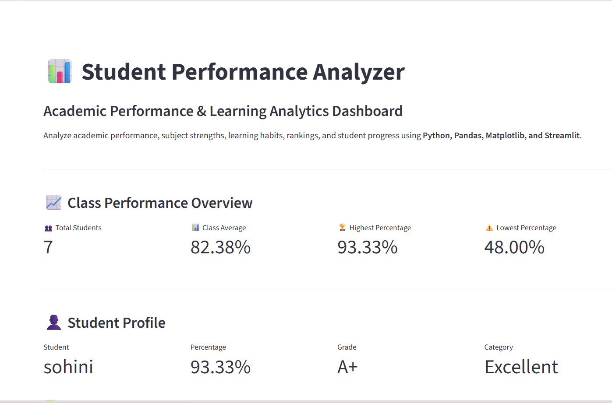
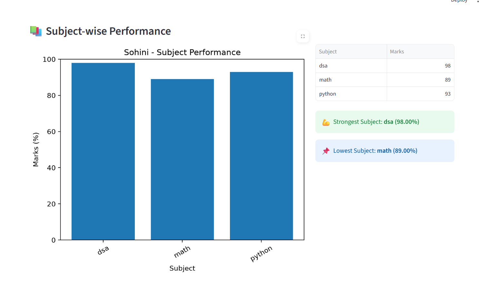
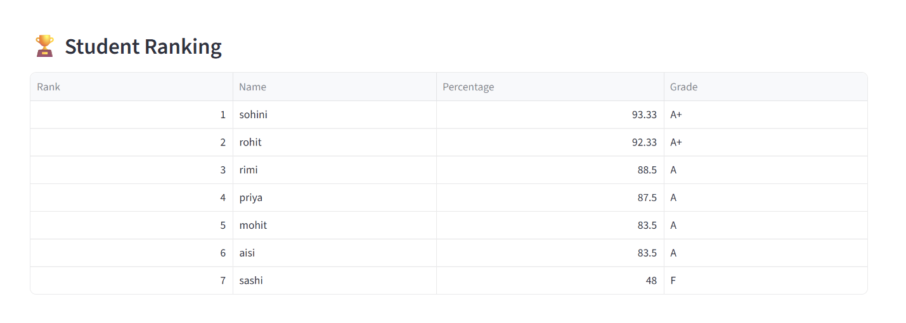
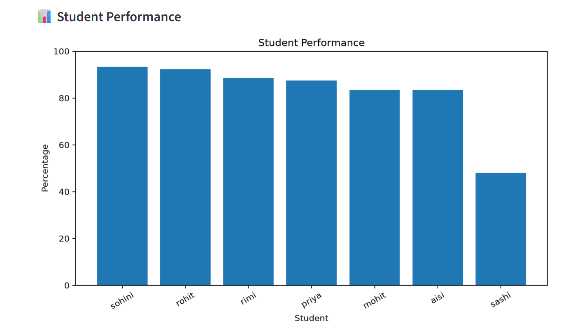
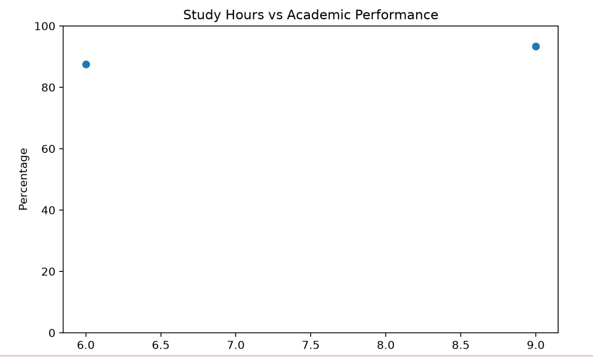
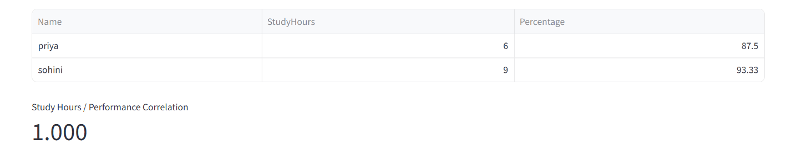
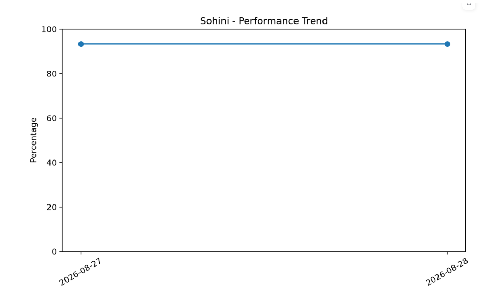
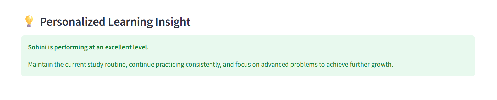

# 📊 Student Performance Analyzer

### Academic Analytics · Performance Tracking · Learning Insights

A Python-based academic analytics application that helps analyze student performance, compare academic results, visualize class statistics, track performance trends, and generate student reports.

The project combines data analysis, visualization, and an interactive Streamlit dashboard to turn academic records into meaningful insights.

<p>
  
  
  
  
</p>

---

## 📌 Overview

Student Performance Analyzer brings student records and academic analytics together in one application.

It supports student record management, marks and grade calculations, student comparisons, class-level statistics, subject-wise analysis, study-hour analysis, performance trends, and report generation.

The application also includes an interactive dashboard built with Streamlit for exploring academic performance and visualizing important patterns.

## ✨ Key Features

### 👨‍🎓 Student Management

* Add, update, view, and search student records.
* Store subject-wise marks.
* Calculate total marks, percentages, and grades.
* Validate student information and prevent duplicate records.

### 📊 Academic Analytics

* Calculate class averages and subject averages.
* Rank students by academic performance.
* Analyze grade distributions and performance categories.
* Identify top-performing and lower-performing students.
* Compare academic results across students and subjects.

### 📈 Performance Tracking

* Track changes in student performance over time.
* Compare current and previous results.
* Identify improving, declining, and stable performance.
* Analyze study hours alongside academic outcomes.

### 📉 Data Visualization

* Student performance charts.
* Grade distribution.
* Performance category analysis.
* Subject-wise performance.
* Study hours versus performance.
* Performance trend charts.

### 💡 Student Insights

* Generate individual student profiles.
* Identify stronger and weaker subjects.
* Analyze learning habits when data is available.
* Provide rule-based learning recommendations.

### 📄 Report Generation

* Generate student reports.
* Create PDF reports using ReportLab.
* Store generated reports in the reports directory.

## 🖥️ Interactive Dashboard

The Streamlit dashboard provides an interactive interface for exploring academic data.

Run the dashboard with:

```bash
streamlit run dashboard.py
```

Explore student profiles, class statistics, rankings, subject-wise performance, grade distributions, performance trends, and learning insights.

## 📸 Dashboard Preview

The repository includes screenshots of the dashboard and its analytics.

### Dashboard Overview



### Student Profile



### Grade Distribution



### Performance Categories



### Subject Performance



### Study Hours Analysis



### Performance Trends



### Personalized Learning Insights



## 🛠️ Technology Stack

| Technology     | Purpose                                 |
| -------------- | --------------------------------------- |
| Python         | Application logic and data processing   |
| Pandas         | Data analysis and statistical summaries |
| Streamlit      | Interactive web dashboard               |
| Matplotlib     | Data visualization                      |
| ReportLab      | PDF report generation                   |
| CSV            | Structured data storage                 |
| Git and GitHub | Version control and project hosting     |

## 📁 Project Structure

```text
student-performance-analyzer/
├── data/
├── reports/
├── screenshots/
├── frontend/
├── main.py
├── dashboard.py
├── student.py
├── analyzer.py
├── analytics.py
├── data_analysis.py
├── visualizations.py
├── student_profile.py
├── performance_comparison.py
├── performance_trend.py
├── class_dashboard.py
├── report_generator.py
├── pdf_report_generator.py
├── utils.py
├── requirements.txt
├── .gitignore
└── README.md
```

The `data/` and `reports/` directories are used for application data and generated reports. The `frontend/` directory contains the project's frontend components.

## 🚀 Getting Started

### Prerequisites

* Python 3 installed.
* Git installed.
* A terminal or command prompt.

### 1. Clone the repository

```bash
git clone https://github.com/ballsohini939-alt/student-performance-analyzer.git
```

### 2. Navigate to the project

```bash
cd student-performance-analyzer
```

### 3. Create a virtual environment

```bash
python -m venv .venv
```

Activate it on Windows:

```powershell
.venv\Scripts\Activate.ps1
```

Activate it on macOS or Linux:

```bash
source .venv/bin/activate
```

### 4. Install dependencies

```bash
python -m pip install -r requirements.txt
```

### 5. Run the console application

```bash
python main.py
```

### 6. Launch the interactive dashboard

```bash
streamlit run dashboard.py
```

The dashboard should open in your default browser.

## 🎯 Learning Outcomes

This project demonstrates practical experience with:

* Python programming and modular code organization.
* Data processing with Pandas.
* Statistical analysis and academic metrics.
* Data visualization using Matplotlib.
* Interactive dashboards with Streamlit.
* File handling and structured data.
* PDF report generation.
* Input validation and data integrity.
* Version control using Git and GitHub.

## 🔮 Future Enhancements

Potential future improvements include:

* SQLite database integration.
* Automated testing.
* CSV and Excel data import.
* Additional interactive dashboard filters.
* Machine-learning-based performance prediction.
* More advanced predictive analytics.
* Improved responsive design.

These are planned enhancements rather than claims about existing functionality.

## 👩‍💻 Author

**Sohini Ball**
B.Tech Computer Science and Engineering Student | Aspiring Software Engineer

[GitHub Profile](https://github.com/ballsohini939-alt) · [LinkedIn Profile](https://www.linkedin.com/in/sohini-ball-698012381/)

---

⭐ If you find this project interesting, consider starring the repository!

